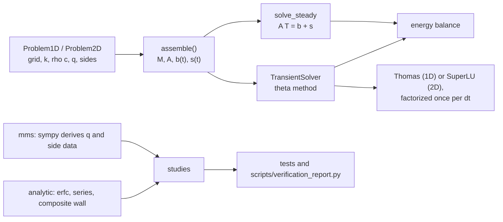

# verified-diffusion

A finite-volume solver for transient heat conduction in one and two dimensions,
written so that its correctness can be checked rather than assumed. It solves

$$
\rho c\,\frac{\partial T}{\partial t} = \nabla\cdot\left(k\,\nabla T\right) + q(\mathbf{x}, t)
$$

on intervals and rectangles, on uniform or stretched grids, with conductivity
that varies in space, Dirichlet, Neumann or Robin conditions on each side (fixed
or time dependent), explicit Euler, Crank-Nicolson, implicit Euler and steady
solves. The point of the repository is the evidence: the test suite shows, with
manufactured solutions, analytic solutions and grid-convergence studies, that
the solver converges at its theoretical order in space and time and that every
time step conserves energy to round-off.

## Quick start

```bash
git clone https://github.com/jersoncoder/verified-diffusion.git
cd verified-diffusion
python -m venv .venv && . .venv/bin/activate
pip install -e ".[dev]"   # or: pip install -e .  (the solver alone needs only numpy and scipy)
```

```python
from verified_diffusion import (
    Dirichlet,
    Grid1D,
    Problem1D,
    Robin,
    StabilityError,
    TransientSolver,
)

# A 5 cm steel plate at 20 C: one face is suddenly held at 100 C,
# the other loses heat to 20 C air through h = 25 W/(m^2 K).
problem = Problem1D(
    Grid1D.uniform(0.0, 0.05, 50),
    left=Dirichlet(100.0),
    right=Robin(h=25.0, ambient=20.0),
    conductivity=45.0,  # W/(m K)
    heat_capacity=3.6e6,  # rho * c, J/(m^3 K)
)

# Crank-Nicolson, with two implicit start-up steps for the sudden change at t = 0.
run = TransientSolver(problem, "crank-nicolson").run(20.0, t_end=600.0, dt=5.0, startup_steps=2)
stored, boundary, source = run.total_balance()
print(f"cell next to the cooled face after 600 s: {run.temperature[-1]:.2f} C")
print(f"heat stored {stored:.4e} J/m^2, heat that entered {boundary:.4e} J/m^2")
print(f"every step balances to round-off: {run.max_relative_residual < 1e-14}")

# Explicit Euler refuses a step beyond its stability limit.
try:
    TransientSolver(problem, "explicit-euler").run(20.0, t_end=600.0, dt=5.0)
except StabilityError as error:
    print(error)
```

This is [`examples/quickstart.py`](examples/quickstart.py); running it prints
(a test checks that this block matches the script's output):

<!-- quickstart-output:start -->
```text
cell next to the cooled face after 600 s: 97.81 C
heat stored 1.4199e+07 J/m^2, heat that entered 1.4199e+07 J/m^2
every step balances to round-off: True
explicit-euler is unstable for dt=5: the grid Fourier number Fo = 62.5 exceeds the stability limit 0.5; the largest stable time step is dt_max = 0.04
```
<!-- quickstart-output:end -->

A 2D problem has the same shape: a `Grid2D` (the tensor product of two `Grid1D`),
four sides (`left`, `right`, `bottom`, `top`), and boundary data written as
`f(s, t)` with `s` the coordinate along the side. `solve_steady(problem)` returns
the steady field and its energy balance.

## Design



**Finite volumes.** Each cell's unknown is its centre temperature. Integrating
the equation over cell $i$ turns it into a heat balance,

$$
M\,\frac{dT}{dt} = -A\,T + b(t) + s(t), \qquad M = \mathrm{diag}(\rho c_i V_i),
$$

where an interior face between cells $i$ and $j$ carries the heat flow
$G_{ij}(T_j - T_i)$ with

$$
G_{ij} = \frac{A_f}{d_i / k_i + d_j / k_j},
$$

two half-cell resistances in series ($d$ is the centre-to-face distance and $A_f$
the face area). A boundary face uses the same two-point form across the half cell
between the face and the first centre: $G_b = A_f k_1 / d$ for Dirichlet,
$A_f / (d/k_1 + 1/h)$ for Robin, and a prescribed inflow for Neumann. $b(t)$
carries the boundary data and $s(t) = V_i\,q(\mathbf{x}_i, t)$ the source. $A$ is a
symmetric M-matrix: tridiagonal in 1D, five-point in 2D.

```
   boundary face                 interior face
        |<---- d ---->|<---- d ---->|<------- dx_2 ------->|
        |             o             |          o           |
       T_b           T_1                      T_2
```

**Time integration.** The theta method,

$$
(M + \theta\,\Delta t\,A)\,T^{n+1} = (M - (1-\theta)\,\Delta t\,A)\,T^n
+ \Delta t\left[\theta\,r^{n+1} + (1-\theta)\,r^n\right], \qquad r = b + s,
$$

with $\theta = 0$ (explicit Euler), $1/2$ (Crank-Nicolson) or $1$ (implicit
Euler). The matrix on the left is factorized once and reused while $\Delta t$
stays the same: the Thomas algorithm in 1D (`TridiagonalLU`), SuperLU in 2D.

**Energy balance.** Interior face flows cancel in pairs, so summing the rows of
the update gives, for every step,

$$
\sum_i M_i\,(T_i^{n+1} - T_i^n) = \Delta t\left[\theta Q^{n+1} + (1-\theta) Q^n\right]
+ \Delta t\left[\theta S^{n+1} + (1-\theta) S^n\right],
$$

with $Q$ the heat flow entering through the boundary (reported per side) and $S$
the total source. Each `StepBalance` reports the three terms and their residual.

**Stability.** For $\theta < 1/2$ the scheme is stable only for
$\Delta t\,\lambda_{\max}(M^{-1}A)\,(1 - 2\theta) \le 2$. The solver bounds
$\lambda_{\max}$ by Gershgorin, $\lambda_G = \max_i \sum_j |A_{ij}| / M_i$, and
reports the grid Fourier number $Fo = \Delta t\,\lambda_G / 4$, which is
$\alpha\Delta t/\Delta x^2$ on a uniform 1D grid and
$\alpha\Delta t\,(1/\Delta x^2 + 1/\Delta y^2)$ on a uniform 2D grid. A step with
$Fo > 1/(2(1 - 2\theta))$ raises `StabilityError`, naming $Fo$ and the largest
stable step.

## Decisions and trade-offs

* **Cell-centred finite volumes rather than finite differences.** Conservation
  holds by construction, so the energy balance closes to round-off for every
  scheme and grid and can be asserted in tests, not only approximately checked.
* **Harmonic averaging of conductivity at faces.** It is the series-resistance
  formula, exact when $k$ jumps on a face: a composite wall comes out to
  round-off on any grid with faces at the interfaces, where distance-weighted
  arithmetic averaging is first order (both are in the report).
* **Two-point boundary fluxes over the half cell** (equivalent to a linearly
  extrapolated mirror ghost cell). Its local truncation error in a Dirichlet
  boundary cell is $O(1)$, but the global error is $O(h^2)$: the $O(h)$ flux
  defect acts across a resistance of $O(h)$. A quadratic ghost cell would make
  $A$ non-symmetric for a smaller error constant, not a higher order. The
  derivation is in [docs/boundary-conditions.md](docs/boundary-conditions.md).
* **Boundary data and sources weighted like the unknowns** ($\theta$ at the new
  time, $1 - \theta$ at the old). Evaluating them at one end of the step only
  would make Crank-Nicolson first order with time-dependent data; the time
  studies use time-dependent Neumann and Robin data and a time-dependent source
  to check this.
* **Rannacher start-up for Crank-Nicolson.** Its amplification factor tends to
  $-1$ for stiff modes, so data that jump at $t = 0$ leave an oscillation it never
  damps. `run(..., startup_steps=2)` replaces the first two steps by implicit
  Euler half steps. The report shows plain Crank-Nicolson failing to converge in
  the max norm on the step-temperature problem and the start-up restoring order 2.
* **One factorization per time step size.** Material properties and Robin
  coefficients are constant in time, so $M + \theta\Delta t A$ never changes
  during a run. That is the reason `Robin.h` is a constant.
* **Gershgorin for the explicit limit** instead of an eigenvalue solve: cheap and
  always an upper bound, so the limit it gives is safe, and on a uniform grid it
  is close to the exact spectral radius (a test compares the two with a dense
  eigenvalue computation).
* **The Thomas algorithm written out in Python.** The factorization is visible
  and tested on its own; it does not pivot, which is safe because the 1D matrices
  are diagonally dominant M-matrices. It is slower than LAPACK's banded solvers
  for large $n$, which does not matter at the sizes a 1D verification study needs.
* **Temporal order measured against the semi-discrete solution.** The time
  studies integrate the same semi-discrete system with scipy's Radau method at a
  tight tolerance; the spatial error is common to both and cancels, so the
  observed order is that of the time integrator alone, explicit Euler included
  (whose step limit would otherwise tie its time error to the spatial one).

## How correctness is verified

The verification studies live in
[`src/verified_diffusion/studies.py`](src/verified_diffusion/studies.py). The
test suite runs them and asserts on their results, and
`scripts/verification_report.py` runs the same functions to write
[docs/verification.md](docs/verification.md), which has the full tables, the
GCI analysis, the energy-balance residuals and the plots.

* **Manufactured solutions.** sympy derives the source and the data of every
  side from chosen smooth solutions, including a variable-$k$ case, stretched
  grids, time-dependent data on all three kinds of side, and variable heat
  capacity. Spatial order is measured over five or six grids; temporal order over
  five time steps for each scheme.
* **Analytic solutions.** The semi-infinite solid with a step surface
  temperature (erfc), a plane wall cooled by convection (Fourier series over the
  roots of $\lambda\tan\lambda = Bi$), a steady plate with a sine-series solution,
  and a two-layer composite wall.
* **Grid Convergence Index.** Roache's GCI and Richardson extrapolation
  (`verified_diffusion.gci`), tested on sequences with known limits and applied
  on four grids to a heated plate with no closed-form solution.
* **Energy balance.** Every step of every scheme, in 1D and 2D, with every kind
  of side and a source, closes to round-off relative to the magnitude of the
  terms in the balance.
* **Unit tests** for the grid, the Thomas solver, matrix structure (symmetry,
  M-matrix signs, column sums equal to boundary conductances), exactness for
  linear fields, the stability limit and its error message, and argument checks.

Observed order between the two finest levels, from the last run of the report
script. The tests require each order to lie within 0.1 of the theoretical one,
except the max norm on the stretched 2D grid, which is held to a floor of 1.75
(the report explains why):

<!-- verification-summary:start -->
| study | expected | observed, L2 | observed, max | note |
|---|---:|---:|---:|---|
| 1D steady, uniform grid, constant k, Dirichlet/Dirichlet | 2 | 2.00 | 2.00 |  |
| 1D steady, stretched grid, variable k, Robin/Neumann | 2 | 2.01 | 1.98 |  |
| 1D Crank-Nicolson, dt = h/4, stretched grid, variable k and rho*c, Dirichlet/Robin(t) | 2 | 2.00 | 2.00 |  |
| 2D steady, stretched grid, variable k, Dirichlet/Robin/Neumann/Dirichlet | 2 | 2.00 | 1.96 | max norm converges slowly near a corner, see Order in space |
| 2D Crank-Nicolson, dt = h/4, stretched grid, variable k and rho*c, mixed sides (t) | 2 | 2.00 | 1.81 | max norm converges slowly near a corner, see Order in space |
| crank-nicolson, 1D, 16 cells, variable k and rho*c, Neumann(t)/Robin(t), error against the semi-discrete reference | 2 | 2.00 | 2.00 |  |
| implicit-euler, 1D, 16 cells, variable k and rho*c, Neumann(t)/Robin(t), error against the semi-discrete reference | 1 | 1.00 | 1.00 |  |
| explicit-euler, 1D, 16 cells, variable k and rho*c, Neumann(t)/Robin(t), error against the semi-discrete reference | 1 | 1.00 | 1.00 |  |
| semi-infinite solid, step surface temperature, crank-nicolson, no start-up steps, dt proportional to h | 2 | 0.50 | -0.00 | no start-up steps, on purpose: the known failure mode |
| semi-infinite solid, step surface temperature, crank-nicolson, 2 start-up steps, dt proportional to h | 2 | 2.00 | 2.00 |  |
| semi-infinite solid, step surface temperature, implicit-euler, no start-up steps, dt proportional to h | 1 | 1.00 | 1.00 |  |
| slab with convection (Bi = 5), Fourier series at Fo = 0.3, Crank-Nicolson, no start-up steps | 2 | 1.69 | 0.93 | no start-up steps, on purpose |
| slab with convection (Bi = 5), Fourier series at Fo = 0.3, Crank-Nicolson, 2 start-up steps | 2 | 2.00 | 2.00 |  |
| 2D steady plate, parabolic top edge, Fourier sine series | 2 | 2.00 | 1.98 |  |
<!-- verification-summary:end -->


## Limitations

These are deliberate omissions, not hidden failures.

* **Linear problems only.** Conductivity and heat capacity may vary in space but
  not with temperature or time; there is no nonlinear (Picard or Newton)
  iteration.
* **Robin coefficients are constant** in time and along each side (the ambient
  temperature may vary). Radiation is not modelled.
* **Rectangular, Cartesian geometry**: intervals and rectangles on tensor-product
  grids. No 3D, no cylindrical or spherical coordinates, no unstructured meshes,
  no internal boundaries other than conductivity jumps on cell faces.
* **Fixed time steps.** There is no adaptive time stepping or error control;
  `run` takes equal steps (shortened slightly so they land on `t_end`).
* **Explicit Euler is stable up to $Fo = 1/2$ but not monotone there.** Next to
  a Dirichlet side the boundary cell's diagonal is $3\alpha/\Delta x^2$ on a
  uniform 1D grid, so its own coefficient in the update turns negative above
  $Fo = 1/3$ and the discrete maximum principle can fail between those two values.
* **Max-norm order on stretched 2D grids** approaches 2 more slowly than the L2
  order, with the largest error in the top row of cells near a corner, where
  the cells are tall and narrow.
  The convergence argument for the boundary closure is a 1D steady one; the 2D
  and transient evidence is the measured orders.
* **Plain Crank-Nicolson with discontinuous data** does not converge in the max
  norm; use `startup_steps`.
* **Performance is not a goal.** The 1D solve is pure Python, the 2D solve uses
  SuperLU with its default settings, and there is no parallelism.

## Development

```bash
python -m venv .venv && . .venv/bin/activate   # or: uv venv && uv pip install -e ".[dev]"
pip install -e ".[dev]"

ruff check .
ruff format --check .
mypy
pytest                  # the default suite, no network
pytest -m slow          # adds an end-to-end run of the report script
python scripts/verification_report.py   # rewrites docs/verification.md, docs/img/ and the table above
python examples/quickstart.py
```

CI installs `.[dev]` and runs `ruff check`, `ruff format --check`, `mypy` and
`pytest` on Python 3.11, 3.12 and 3.13.

## License

MIT, see [LICENSE](LICENSE).
