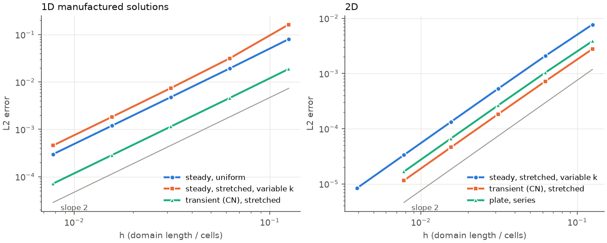
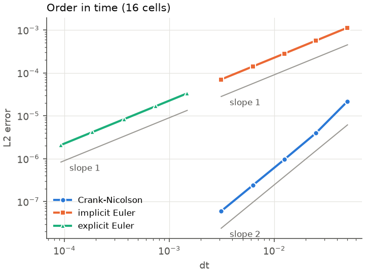
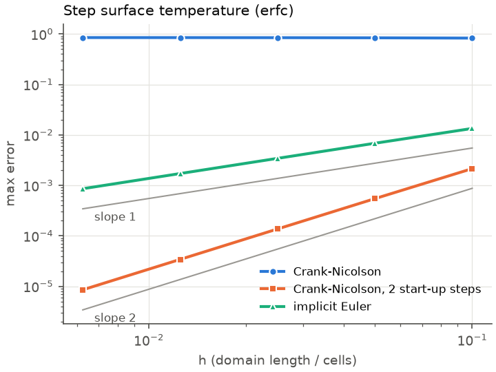

# Verification report

Generated by `python scripts/verification_report.py` (Python 3.11.16, numpy 2.4.6, scipy 1.17.1, Linux x86_64).
Every number below comes from that run; the test suite
(`tests/test_studies.py`) runs the same study functions and asserts on the same
quantities. Orders are observed between consecutive levels:
$p = \ln(e_k / e_{k+1}) / \ln(h_k / h_{k+1})$. The L2 error is volume weighted,
$\lVert e \rVert_2 = \sqrt{\sum_i V_i e_i^2 / \sum_i V_i}$, and the max error is
taken over cell centres.

## Summary

Observed order between the two finest levels.

| study | expected | observed, L2 | observed, max | note |
|---|---:|---:|---:|---|
| 1D steady, uniform grid, constant k, Dirichlet/Dirichlet | 2 | 2.00 | 2.00 |  |
| 1D steady, stretched grid, variable k, Robin/Neumann | 2 | 2.01 | 1.98 |  |
| 1D Crank-Nicolson, dt = h/4, stretched grid, variable k and rho*c, Dirichlet/Robin(t) | 2 | 2.00 | 2.00 |  |
| 2D steady, stretched grid, variable k, Dirichlet/Robin/Neumann/Dirichlet | 2 | 2.00 | 1.96 | max norm converges slowly near a corner, see Order in space |
| 2D Crank-Nicolson, dt = h/4, stretched grid, variable k and rho*c, mixed sides (t) | 2 | 2.00 | 1.81 | max norm converges slowly near a corner, see Order in space |
| crank-nicolson, 1D, 16 cells, variable k and rho*c, Neumann(t)/Robin(t), error against the semi-discrete reference | 2 | 2.00 | 2.00 |  |
| implicit-euler, 1D, 16 cells, variable k and rho*c, Neumann(t)/Robin(t), error against the semi-discrete reference | 1 | 1.00 | 1.00 |  |
| explicit-euler, 1D, 16 cells, variable k and rho*c, Neumann(t)/Robin(t), error against the semi-discrete reference | 1 | 1.00 | 1.00 |  |
| semi-infinite solid, step surface temperature, crank-nicolson, no start-up steps, dt proportional to h | 2 | 0.50 | -0.00 | no start-up steps, on purpose: the known failure mode |
| semi-infinite solid, step surface temperature, crank-nicolson, 2 start-up steps, dt proportional to h | 2 | 2.00 | 2.00 |  |
| semi-infinite solid, step surface temperature, implicit-euler, no start-up steps, dt proportional to h | 1 | 1.00 | 1.00 |  |
| slab with convection (Bi = 5), Fourier series at Fo = 0.3, Crank-Nicolson, no start-up steps | 2 | 1.69 | 0.93 | no start-up steps, on purpose |
| slab with convection (Bi = 5), Fourier series at Fo = 0.3, Crank-Nicolson, 2 start-up steps | 2 | 2.00 | 2.00 |  |
| 2D steady plate, parabolic top edge, Fourier sine series | 2 | 2.00 | 1.98 |  |

## Order in space (manufactured solutions)

Sources and boundary data are derived with sympy from the chosen solutions in
`src/verified_diffusion/studies.py`. Transient cases use Crank-Nicolson with
$\Delta t = h/4$, so time and space errors both fall as $h^2$. Stretched grids use
the tanh mapping of `Grid1D.stretched` ($\beta = 2$ in 1D, $\beta = 1.5$ in 2D).

**1D steady, uniform grid, constant k, Dirichlet/Dirichlet** (`steady-1d-uniform`)

| cells per direction | h | L2 error | order | max error | order |
|---:|---:|---:|---:|---:|---:|
| 8 | 0.125 | 8.012e-02 |  | 1.439e-01 |  |
| 16 | 0.0625 | 1.935e-02 | 2.05 | 3.489e-02 | 2.04 |
| 32 | 0.03125 | 4.797e-03 | 2.01 | 8.687e-03 | 2.01 |
| 64 | 0.01562 | 1.197e-03 | 2.00 | 2.165e-03 | 2.00 |
| 128 | 0.007812 | 2.990e-04 | 2.00 | 5.414e-04 | 2.00 |

**1D steady, stretched grid, variable k, Robin/Neumann** (`steady-1d-stretched`)

| cells per direction | h | L2 error | order | max error | order |
|---:|---:|---:|---:|---:|---:|
| 8 | 0.125 | 1.634e-01 |  | 2.544e-01 |  |
| 16 | 0.0625 | 3.162e-02 | 2.37 | 4.718e-02 | 2.43 |
| 32 | 0.03125 | 7.448e-03 | 2.09 | 1.145e-02 | 2.04 |
| 64 | 0.01562 | 1.835e-03 | 2.02 | 2.905e-03 | 1.98 |
| 128 | 0.007812 | 4.570e-04 | 2.01 | 7.353e-04 | 1.98 |

**1D Crank-Nicolson, dt = h/4, stretched grid, variable k and rho*c, Dirichlet/Robin(t)** (`transient-1d-cn`)

| cells per direction | h | L2 error | order | max error | order |
|---:|---:|---:|---:|---:|---:|
| 8 | 0.125 | 1.882e-02 |  | 2.873e-02 |  |
| 16 | 0.0625 | 4.611e-03 | 2.03 | 6.976e-03 | 2.04 |
| 32 | 0.03125 | 1.147e-03 | 2.01 | 1.755e-03 | 1.99 |
| 64 | 0.01562 | 2.864e-04 | 2.00 | 4.386e-04 | 2.00 |
| 128 | 0.007812 | 7.158e-05 | 2.00 | 1.096e-04 | 2.00 |

**2D steady, stretched grid, variable k, Dirichlet/Robin/Neumann/Dirichlet** (`steady-2d-stretched`)

| cells per direction | h | L2 error | order | max error | order |
|---:|---:|---:|---:|---:|---:|
| 8 | 0.125 | 7.692e-03 |  | 2.556e-02 |  |
| 16 | 0.0625 | 2.079e-03 | 1.89 | 8.377e-03 | 1.61 |
| 32 | 0.03125 | 5.301e-04 | 1.97 | 2.395e-03 | 1.81 |
| 64 | 0.01562 | 1.332e-04 | 1.99 | 6.461e-04 | 1.89 |
| 128 | 0.007812 | 3.334e-05 | 2.00 | 1.687e-04 | 1.94 |
| 256 | 0.003906 | 8.337e-06 | 2.00 | 4.326e-05 | 1.96 |

**2D Crank-Nicolson, dt = h/4, stretched grid, variable k and rho*c, mixed sides (t)** (`transient-2d-cn`)

| cells per direction | h | L2 error | order | max error | order |
|---:|---:|---:|---:|---:|---:|
| 8 | 0.125 | 2.772e-03 |  | 6.826e-03 |  |
| 16 | 0.0625 | 7.217e-04 | 1.94 | 1.749e-03 | 1.96 |
| 32 | 0.03125 | 1.833e-04 | 1.98 | 4.812e-04 | 1.86 |
| 64 | 0.01562 | 4.608e-05 | 1.99 | 1.484e-04 | 1.70 |
| 128 | 0.007812 | 1.154e-05 | 2.00 | 4.228e-05 | 1.81 |

On the stretched 2D grid the max-norm order approaches 2 more slowly than the L2
order. On the finest level the largest error of the steady case is in the cell
centred at $(0.997, 0.997)$ and that of the transient case in the cell centred at
$(0.038, 0.994)$. Both are in the top row, where the y-grid has its tallest
cells, close to a top corner, where the x-grid has its narrowest ones; those two
cells are 5.2 and 3.3 times taller than they are
wide. The max-norm orders of the steady case, level by level, are 1.61, 1.81, 1.89, 1.94, 1.96;
those of the transient case are 1.96, 1.86, 1.70, 1.81. The tests hold the 2D max-norm
order to a floor of 1.75 and every other order to
$\pm 0.1$ of the theory.

## Order in time

The grid is fixed (16 uniform cells) and the error is measured against the
time-exact solution of the same semi-discrete system,
$M\,\dot T = -A\,T + b(t) + s(t)$, integrated by scipy's Radau method at a relative
tolerance of $10^{-12}$. The spatial error is common to both and cancels, so what
remains is the error of the time integrator alone, including its treatment of
time-dependent Neumann and Robin data and a time-dependent source. Explicit Euler
starts at the largest equal step within its stability limit.

**crank-nicolson, 1D, 16 cells, variable k and rho*c, Neumann(t)/Robin(t), error against the semi-discrete reference** (`time-crank-nicolson`)

| steps | dt | L2 error | order | max error | order |
|---:|---:|---:|---:|---:|---:|
| 10 | 0.05 | 2.175e-05 |  | 6.876e-05 |  |
| 20 | 0.025 | 3.951e-06 | 2.46 | 7.418e-06 | 3.21 |
| 40 | 0.0125 | 9.587e-07 | 2.04 | 1.507e-06 | 2.30 |
| 80 | 0.00625 | 2.397e-07 | 2.00 | 3.765e-07 | 2.00 |
| 160 | 0.003125 | 5.991e-08 | 2.00 | 9.413e-08 | 2.00 |

**implicit-euler, 1D, 16 cells, variable k and rho*c, Neumann(t)/Robin(t), error against the semi-discrete reference** (`time-implicit-euler`)

| steps | dt | L2 error | order | max error | order |
|---:|---:|---:|---:|---:|---:|
| 10 | 0.05 | 1.131e-03 |  | 1.843e-03 |  |
| 20 | 0.025 | 5.643e-04 | 1.00 | 9.222e-04 | 1.00 |
| 40 | 0.0125 | 2.818e-04 | 1.00 | 4.610e-04 | 1.00 |
| 80 | 0.00625 | 1.408e-04 | 1.00 | 2.305e-04 | 1.00 |
| 160 | 0.003125 | 7.037e-05 | 1.00 | 1.152e-04 | 1.00 |

**explicit-euler, 1D, 16 cells, variable k and rho*c, Neumann(t)/Robin(t), error against the semi-discrete reference** (`time-explicit-euler`)

| steps | dt | L2 error | order | max error | order |
|---:|---:|---:|---:|---:|---:|
| 337 | 0.001484 | 3.339e-05 |  | 5.470e-05 |  |
| 674 | 0.0007418 | 1.670e-05 | 1.00 | 2.735e-05 | 1.00 |
| 1348 | 0.0003709 | 8.349e-06 | 1.00 | 1.368e-05 | 1.00 |
| 2696 | 0.0001855 | 4.175e-06 | 1.00 | 6.838e-06 | 1.00 |
| 5392 | 9.273e-05 | 2.087e-06 | 1.00 | 3.419e-06 | 1.00 |

## Analytic solutions

**Semi-infinite solid with a step surface temperature.** The surface of a solid at
0 is raised to 1 at $t = 0$; $T = \operatorname{erfc}(x / 2\sqrt{\alpha t})$,
compared at $t = 0.05$ on $[0, 2]$ (the far boundary, held at 0, sits at
$x / 2\sqrt{\alpha t} = 4.47$, where the exact solution is
2.5e-10). The time step is proportional to $h$. Plain Crank-Nicolson does not
converge in the max norm: the jump at $t = 0$ excites the stiffest modes, whose
Crank-Nicolson amplification
factor $(1 - \lambda \Delta t/2)/(1 + \lambda \Delta t/2)$ tends to $-1$, so an
oscillation next to the surface survives every refinement. Replacing the first two
steps by two implicit Euler half steps each (Rannacher start-up,
`run(..., startup_steps=2)`) removes it and restores second order; implicit Euler
alone converges at first order.

**Plane wall with convection.** A wall at 1, insulated at $x = 0$ and cooled by
convection to 0 at $x = 1$ ($Bi = 5$), compared at $Fo = 0.3$ with the Fourier
series over the roots of $\lambda \tan \lambda = Bi$. The initial temperature is
incompatible with the Robin condition, a milder version of the step above.

**Steady plate.** The unit square held at 0 on three sides with $4x(1 - x)$ on
the top, compared with its sine series (1001 terms).

**semi-infinite solid, step surface temperature, crank-nicolson, no start-up steps, dt proportional to h** (`erfc-crank-nicolson-0`)

| cells per direction | h | L2 error | order | max error | order |
|---:|---:|---:|---:|---:|---:|
| 20 | 0.1 | 4.567e-02 |  | 8.285e-01 |  |
| 40 | 0.05 | 3.257e-02 | 0.49 | 8.400e-01 | -0.02 |
| 80 | 0.025 | 2.312e-02 | 0.49 | 8.455e-01 | -0.01 |
| 160 | 0.0125 | 1.638e-02 | 0.50 | 8.481e-01 | -0.00 |
| 320 | 0.00625 | 1.159e-02 | 0.50 | 8.495e-01 | -0.00 |

**semi-infinite solid, step surface temperature, crank-nicolson, 2 start-up steps, dt proportional to h** (`erfc-crank-nicolson-2`)

| cells per direction | h | L2 error | order | max error | order |
|---:|---:|---:|---:|---:|---:|
| 20 | 0.1 | 8.780e-04 |  | 2.147e-03 |  |
| 40 | 0.05 | 2.200e-04 | 2.00 | 5.463e-04 | 1.97 |
| 80 | 0.025 | 5.502e-05 | 2.00 | 1.369e-04 | 2.00 |
| 160 | 0.0125 | 1.376e-05 | 2.00 | 3.418e-05 | 2.00 |
| 320 | 0.00625 | 3.439e-06 | 2.00 | 8.546e-06 | 2.00 |

**semi-infinite solid, step surface temperature, implicit-euler, no start-up steps, dt proportional to h** (`erfc-implicit-euler-0`)

| cells per direction | h | L2 error | order | max error | order |
|---:|---:|---:|---:|---:|---:|
| 20 | 0.1 | 5.164e-03 |  | 1.344e-02 |  |
| 40 | 0.05 | 2.570e-03 | 1.01 | 6.836e-03 | 0.97 |
| 80 | 0.025 | 1.282e-03 | 1.00 | 3.433e-03 | 0.99 |
| 160 | 0.0125 | 6.400e-04 | 1.00 | 1.718e-03 | 1.00 |
| 320 | 0.00625 | 3.198e-04 | 1.00 | 8.597e-04 | 1.00 |

**slab with convection (Bi = 5), Fourier series at Fo = 0.3, Crank-Nicolson, no start-up steps** (`slab-0`)

| cells per direction | h | L2 error | order | max error | order |
|---:|---:|---:|---:|---:|---:|
| 10 | 0.1 | 7.135e-04 |  | 9.029e-04 |  |
| 20 | 0.05 | 1.899e-04 | 1.91 | 3.152e-04 | 1.52 |
| 40 | 0.025 | 5.263e-05 | 1.85 | 1.298e-04 | 1.28 |
| 80 | 0.0125 | 1.539e-05 | 1.77 | 6.967e-05 | 0.90 |
| 160 | 0.00625 | 4.772e-06 | 1.69 | 3.649e-05 | 0.93 |

**slab with convection (Bi = 5), Fourier series at Fo = 0.3, Crank-Nicolson, 2 start-up steps** (`slab-2`)

| cells per direction | h | L2 error | order | max error | order |
|---:|---:|---:|---:|---:|---:|
| 10 | 0.1 | 1.460e-03 |  | 1.597e-03 |  |
| 20 | 0.05 | 3.647e-04 | 2.00 | 3.990e-04 | 2.00 |
| 40 | 0.025 | 9.117e-05 | 2.00 | 9.979e-05 | 2.00 |
| 80 | 0.0125 | 2.279e-05 | 2.00 | 2.495e-05 | 2.00 |
| 160 | 0.00625 | 5.698e-06 | 2.00 | 6.237e-06 | 2.00 |

**2D steady plate, parabolic top edge, Fourier sine series** (`plate-2d`)

| cells per direction | h | L2 error | order | max error | order |
|---:|---:|---:|---:|---:|---:|
| 8 | 0.125 | 3.849e-03 |  | 1.220e-02 |  |
| 16 | 0.0625 | 1.036e-03 | 1.89 | 3.498e-03 | 1.80 |
| 32 | 0.03125 | 2.650e-04 | 1.97 | 9.261e-04 | 1.92 |
| 64 | 0.01562 | 6.669e-05 | 1.99 | 2.378e-04 | 1.96 |
| 128 | 0.007812 | 1.671e-05 | 2.00 | 6.025e-05 | 1.98 |

## Composite wall

Two layers, $k = 1$ on $[0, 0.3]$ and $k = 20$ on $[0.3, 1]$, held at 0 and 1,
with the interface on a cell face. The exact profile is piecewise linear. With
harmonic face averaging (resistances in series) the scheme reproduces it to
round-off on uniform and stretched layers; distance-weighted arithmetic averaging
gets the interface flux wrong and converges at first order. Max error at the
cell centres:

| cells per layer | harmonic, uniform | harmonic, stretched | arithmetic | order |
|---:|---:|---:|---:|---:|
| 4 | 2.2e-16 | 7.8e-16 | 5.835e-02 |  |
| 8 | 2.2e-16 | 3.3e-16 | 3.014e-02 | 0.95 |
| 16 | 6.7e-15 | 1.3e-14 | 1.530e-02 | 0.98 |
| 32 | 1.5e-14 | 1.5e-14 | 7.704e-03 | 0.99 |
| 64 | 5.6e-14 | 2.5e-14 | 3.866e-03 | 0.99 |

## Grid Convergence Index

A 2 by 1 plate with a Gaussian heat source, a conductivity that varies with
position, the left side at 0, convection on the right ($h = 10$), an insulated
bottom and a prescribed heat loss on the top: no closed-form solution. Four grids
with refinement ratio 2. The observed orders from the three finest and from the
three coarsest grids differ by at most 0.004, so the grids are in the
asymptotic range. GCI with safety factor 1.25 (Roache).

| quantity | grids (cells) | values | p (finest three) | p (coarsest three) | extrapolated | GCI fine |
|---|---|---|---:|---:|---:|---:|
| mean temperature | 512, 2048, 8192, 32768 | 0.522428, 0.521928, 0.521804, 0.521772 | 2.000 | 1.999 | 0.521762 | 0.0025 % |
| heat flow out of the right side | 512, 2048, 8192, 32768 | -0.461121, -0.461508, -0.461605, -0.461629 | 1.999 | 1.995 | -0.461637 | 0.0022 % |

## Energy balance

Each step reports the change in stored energy, the heat that entered through each
side and the heat released by the source. Their residual divided by the magnitude
of the terms entering the step (`StepBalance.scale`) is at round-off level for
every scheme. The columns give the totals over a run to $t = 0.1$ (J per unit
area in 1D, J per unit depth in 2D).

| case | scheme | steps | stored | boundary | source | worst step residual / scale |
|---|---|---:|---:|---:|---:|---:|
| 1D: Robin(t), Neumann(t), source(x, t), variable k and rho*c, stretched | explicit-euler | 6330 | 13.021299 | -6.701522 | 19.722820 | 3.2e-17 |
| 1D: Robin(t), Neumann(t), source(x, t), variable k and rho*c, stretched | crank-nicolson | 50 | 13.020841 | -6.701922 | 19.722763 | 9.0e-18 |
| 1D: Robin(t), Neumann(t), source(x, t), variable k and rho*c, stretched | implicit-euler | 50 | 12.952788 | -6.766017 | 19.718805 | 1.3e-17 |
| 2D: Dirichlet(y, t), Robin, Neumann(x), Dirichlet, source(x, y, t), variable k | explicit-euler | 2342 | 3.133414 | 0.495328 | 2.638086 | 2.0e-17 |
| 2D: Dirichlet(y, t), Robin, Neumann(x), Dirichlet, source(x, y, t), variable k | crank-nicolson | 50 | 3.133198 | 0.495059 | 2.638139 | 8.3e-18 |
| 2D: Dirichlet(y, t), Robin, Neumann(x), Dirichlet, source(x, y, t), variable k | implicit-euler | 50 | 3.116252 | 0.475600 | 2.640652 | 1.3e-17 |

## Plots

